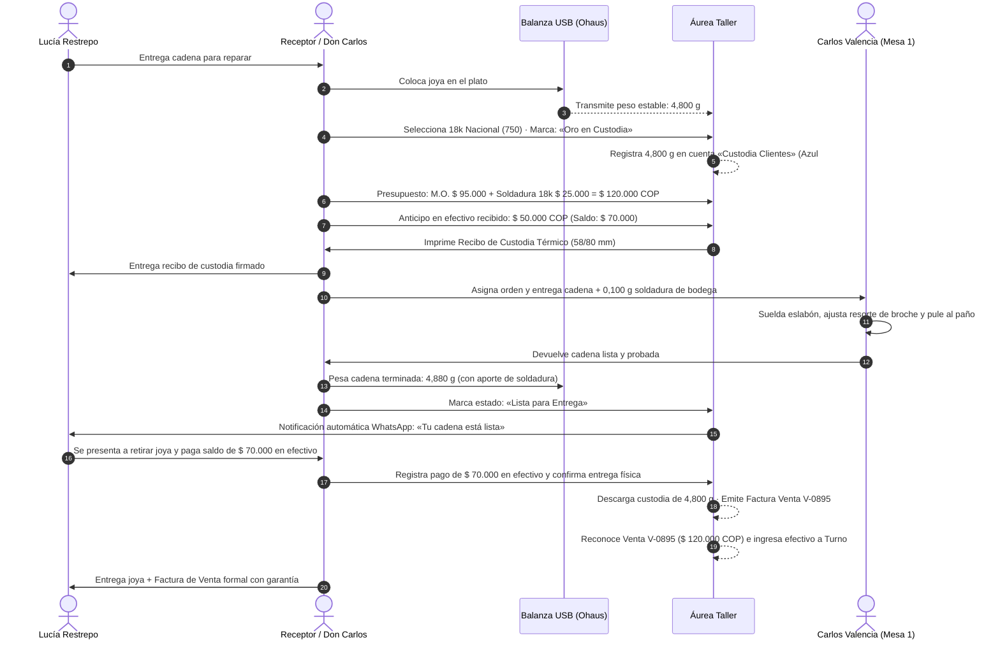
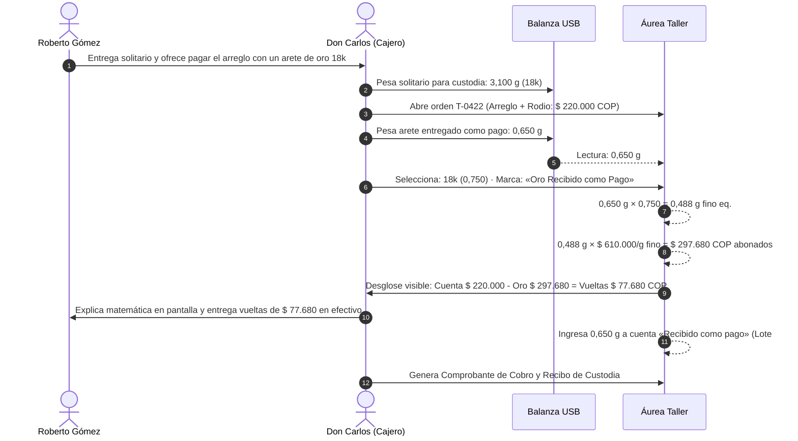
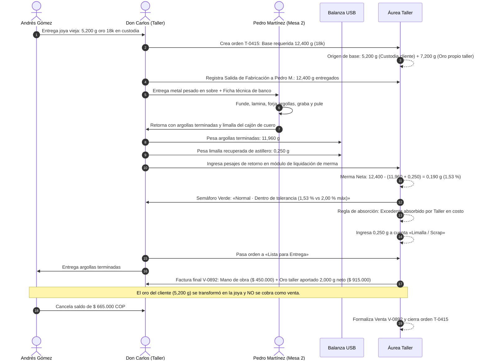
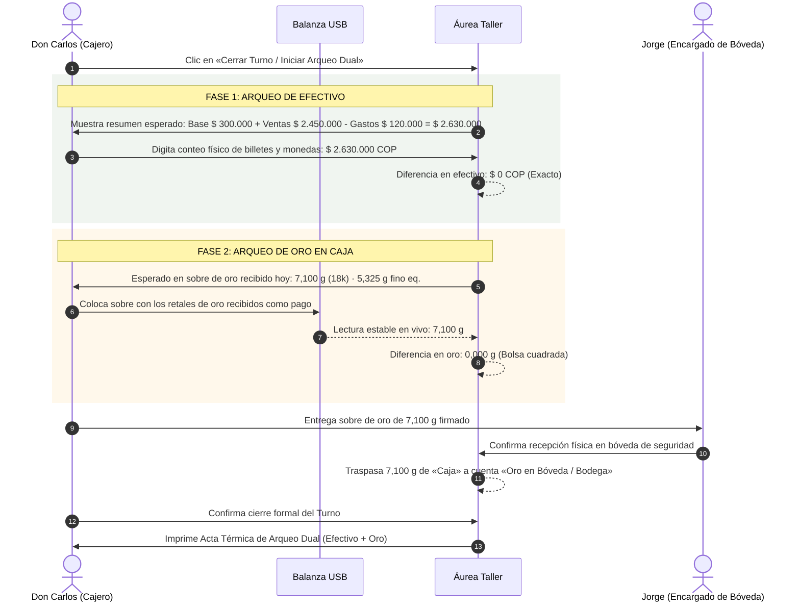

# Áurea Taller · Flujos Críticos Operativos (Fase 3)
**Fase 3 — Flujos Críticos de Orfebrería y Taller**  
*Fecha: 28 de octubre de 2026*  
*Producto: «Áurea Taller» — Software de Gestión para Talleres de Joyería y Orfebrería*  
*Ecosistema: Áurea · Identidad: áurea · «GESTIÓN QUE BRILLA»*

---

## Índice de Flujos Críticos
1. [Flujo 1: Reparación simple cobrada en efectivo](#flujo-1-reparación-simple-cobrada-en-efectivo)
2. [Flujo 2: Reparación pagada en oro](#flujo-2-reparación-pagada-en-oro)
3. [Flujo 3: Fabricación a medida con oro del cliente y merma](#flujo-3-fabricación-a-medida-con-oro-del-cliente-y-merma)
4. [Flujo 4: Fabricación con oro del taller y salida a orfebre](#flujo-4-fabricación-con-oro-del-taller-y-salida-a-orfebre)
5. [Flujo 5: Conciliación y cierre de caja con arqueo de oro](#flujo-5-conciliación-y-cierre-de-caja-con-arqueo-de-oro)

---

### Flujo 1: Reparación simple cobrada en efectivo

**Caso real:** Lucía Restrepo trae una cadena cordón de oro 18k con un eslabón roto y broche vencido. Orden `T-0412`.

- **Puntos clave de UX:**
  - El oro de la cliente nunca entra al patrimonio del taller; se mantiene en cuenta *Custodia Clientes* hasta la entrega.
  - La venta solo se reconoce contablemente al entregar la joya al cliente, descargando la soldadura consumida del inventario de insumos.

---

### Flujo 2: Reparación pagada en oro

**Caso real:** Roberto Gómez repara un anillo solitario (mano de obra $ 180.000 + rodio $ 40.000 = $ 220.000 COP) y paga entregando un arete huérfano de oro 18k.

- **Puntos clave de UX:**
  - El bloque `Peso → Fino → COP` se muestra de frente al cliente con la cotización del día visible.
  - El metal entra directamente a la cuenta patrimonial propia **«Recibido como pago»** (no a custodia ni a chatarra genérica).

---

### Flujo 3: Fabricación a medida con oro del cliente y merma

**Caso real:** Andrés Gómez encarga un par de argollas de matrimonio media caña en oro 18k (Orden `T-0415`). Aporta 5,200 g de oro propio en custodia; el taller suministra 7,200 g de oro de bodega para completar los 12,400 g requeridos. Orfebre: Pedro Martínez.

- **Puntos clave de UX:**
  - El orfebre no puede cerrar la orden sin que el encargado de bodega pese por separado la joya terminada y la limalla de astillero.
  - La limalla se acredita a la cuenta 5 (*Limalla / Scrap*) para posterior refino.
  - La orden discrimina el oro del cliente (no facturable) del oro vendido por el taller.

---

### Flujo 4: Fabricación con oro del taller y salida a orfebre (Stock propio)

**Caso real:** Fabricación de 3 sortijas solitario en oro 18k para vitrina comercial.

1. **Apertura de Ficha de Producción:**
   - Encargado de producción selecciona modelo catálogo `REF-SOL-18K`.
   - BOM: 15,000 g oro 18k bodega + 3 esmeraldas colombianas 0,20 ct + 0,300 g soldadura.
2. **Salida de Bodega a Mesa:**
   - Se pesan 15,000 g en balanza USB del lote de granalla 18k de la cuenta *1. Oro Propio Taller*.
   - Se crea el movimiento de salida a producción a la mesa de Pedro Martínez. El saldo pasa a la cuenta *4. En Proceso*.
3. **Control de Etapas:**
   - Pedro Martínez marca en su tablet de banco: *Fundición completada* $\rightarrow$ *Armado completado* $\rightarrow$ *Engaste completado* $\rightarrow$ *Pulido final*.
4. **Devolución y Liquidación:**
   - Retorno: 3 sortijas terminadas pesan `14,480 g` + limalla recogida `0,310 g`.
   - Merma neta: `15,000 - (14,480 + 0,310) = 0,210 g (1,40 %)`. Semáforo Verde Normal.
5. **Costo de Producción Unitario y Transferencia a Minorista:**
   - Costo total: Metal consumido ($ 6.855.000) + Merma real ($ 96.075) + Gemas ($ 900.000) + Mano de obra Pedro M. ($ 360.000) = `$ 8.211.075 COP` ($ 2.737.025 COP por sortija).
   - El administrador presiona **`[Transferir a Joyería Minorista Áurea]`**: Se generan automáticamente los 3 códigos de barras en el POS minorista con su costo exacto y precio de vitrina sugerido ($ 4.200.000 COP c/u).

---

### Flujo 5: Conciliación y cierre de caja con arqueo de oro

**Caso real:** Cierre de turno de la tarde (Turno #2, Don Carlos).

- **Puntos clave de UX:**
  - El arqueo dual obliga a cerrar dos balances independientes: nunca se mezcla dinero con oro.
  - Si existiera una diferencia en oro (ej. faltante de `0,050 g`), el sistema no permite el cierre simple; exige registrar el incidente en el log de auditoría con la etiqueta **«Por revisar»** y notifica al administrador.
