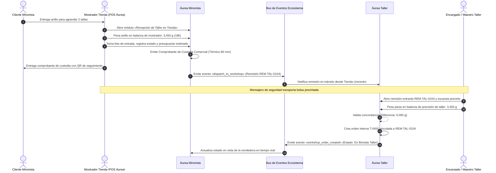
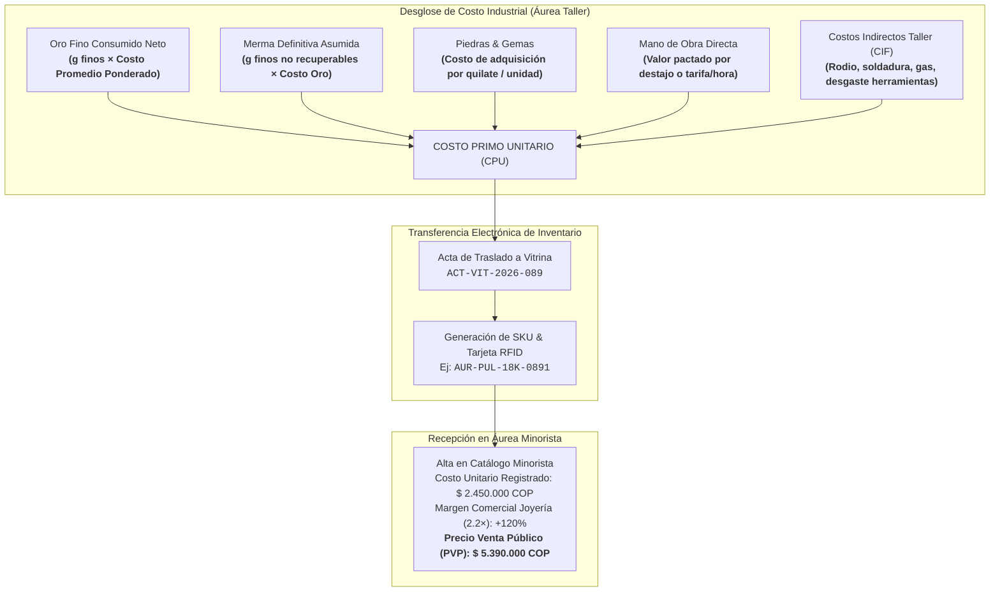
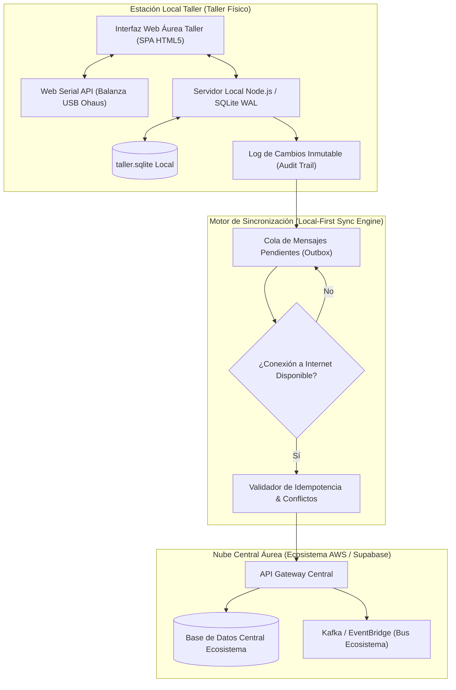

# Áurea Taller · Guía de Escalabilidad y Conexión con Minorista y Mayorista (Fase 4)
**Fase 4 — Arquitectura de Escalabilidad, Ecosistema Unificado y Contratos de Integración**  
*Fecha: 29 de octubre de 2026*  
*Producto: «Áurea Taller» — Software de Gestión para Talleres de Joyería y Orfebrería*  
*Ecosistema: Áurea · Marca: áurea · «GESTIÓN QUE BRILLA»*

---

## 1. Visión General del Ecosistema Áurea

El Ecosistema Áurea está compuesto por tres soluciones especializadas e interoperables que resuelven de punta a punta la cadena de valor de la alta joyería, orfebrería y comercialización de metales preciosos:

```mermaid
flowchart LR
    subgraph MAYORISTA["Áurea Mayorista (Suministro y Refinación)"]
        M1["Importación & Bullion 24k"]
        M2["Lotes de Refinación Ácida"]
        M3["Piedras Preciosas Certificadas"]
    end

    subgraph TALLER["Áurea Taller (Orfebrería y Producción)"]
        T1["Libro de Oro (6 Cuentas)"]
        T2["Órdenes de Trabajo & Merma"]
        T3["Bancos de Joyeros & Fundición"]
        T4["Costeo Industrial Primo"]
    end

    subgraph MINORISTA["Áurea Minorista (Tiendas y Vitrina)"]
        R1["POS & Ventas Mostrador"]
        R2["Inventario Vitrina (SKU/RFID)"]
        R3["Cartera & Crédito Clientes"]
        R4["Recepción de Reparaciones"]
    end

    MAYORISTA -->|"Granalla 24k / Bullion / Insumos"| TALLER
    TALLER -->|"Limallas / Chatarra para Refinar"| MAYORISTA
    TALLER -->|"Joyas Terminadas con Costo Primo"| MINORISTA
    MINORISTA -->|"Reparaciones & Ajustes de Clientes"| TALLER
    MINORISTA -->|"Oro Chatarra Recibido en Parte de Pago"| TALLER
    TALLER -.->|"Cartera y Custodia Sincronizada"| MINORISTA
```



### 1.1 Principios de Identidad y Experiencia Compartidos
1. **Paleta y Lenguaje Visual:** Fondo cálido `#F6F5F1`, tarjetas `#FFFFFF`, bordes `#DCDDD6`, verde de acción `#153F35`, champán `#B49A69`, y tipografía Inter con números tabulares (`font-feature-settings: "tnum"`).
2. **Reserva Semántica del Violeta:** El violeta (`#64439A` / `#F1ECFA`) está estrictamente reservado para **cartera, deudas y saldos por cobrar**. Nunca se utiliza para oro en custodia, el cual se representa con azul informativo `#285B83` / `#EAF2FA` y la leyenda obligatoria `[No es propio]`.
3. **Precisión Numérica de Joyería:**
   - **Pesos:** 3 decimales (`0,001 g`) con tolerancia configurable de balanza (por defecto `±0,005 g`).
   - **Moneda:** Formato colombiano `$ 1.850.000 COP` sin decimales en moneda corriente.
   - **Tarifa Base:** Tarifa del oro por **gramo fino (24k / Ley 999)** como eje indexador; todas las leyes (18k, 14k, 10k) se derivan por factor estricto de quilataje.

---

## 2. Integración con Áurea Minorista (POS y Joyería Comercial)

### 2.1 Flujo A: Recepción de Reparación en Tienda Minorista y Despacho al Taller

En las joyerías comerciales con puntos de venta en centros comerciales o zonas de alta afluencia, los clientes entregan sus joyas en el mostrador de ventas para soldaduras, ajustes de talla, engaste de piedras caídas o baños de oro/rodio.



### 2.2 Flujo B: Reparaciones Contabilizadas como Ventas en el POS

Una reparación entregada y cobrada genera un comprobante de venta formal en el sistema comercial con las siguientes reglas contables:

1. **Momento de Reconocimiento:** La venta se reconoce formalmente al momento de la **entrega física de la joya** (cuando el cliente verifica a satisfacción y salda el importe). Si existen anticipos previos, estos se contabilizan como pasivos («Anticipos de Clientes») hasta la entrega final.
2. **Estructura del Desglose Fiscal en la Factura:**

| Concepto | Tipo Fiscal | Base Gravable | IVA (19%) | Total Facturado | Observación |
| :--- | :--- | :--- | :--- | :--- | :--- |
| **Mano de Obra Orfebrería** (Agrandar anillo) | Servicio | $ 80.000 | $ 15.200 | $ 95.200 | Servicio técnico especializado |
| **Material Aportado por Taller** (0,350 g Oro 18k) | Bien comercial | $ 160.125 | $ 30.424 | $ 190.549 | Oro de bodega consumido |
| **Metal del Cliente en Custodia** (3,450 g Oro 18k) | Custodia / Tercero | $ 0 | $ 0 | $ 0 | Propiedad del cliente; exento de venta |
| **TOTAL FACTURADO** | | **$ 240.125** | **$ 45.624** | **$ 285.749 COP** | Factura electrónica de venta formal |

3. **Movimiento en el Libro de Oro:**
   - La cuenta `Custodia Clientes` descarga exactamente los `3,450 g` devueltos al cliente.
   - La cuenta `Oro Propio del Taller` descarga los `0,350 g` de oro 18k aportados, reconociendo el costo del inventario de materia prima contra el costo de venta.

### 2.3 Flujo C: Pase de Joya Terminada de Fabricación a Vitrina Minorista (Costeo Unitario Exacto)

Cuando el taller finaliza una producción por lote (ej. 10 pulseras eslabón italiano 18k o 5 solitarios de compromiso en platino), estas joyas se transfieren al stock comercial de Áurea Minorista con su **Costo Primo Total** desagregado:



### 2.4 Flujo D: Cartera Unificada 360° del Cliente

Un cliente del ecosistema Áurea posee un identificador fiscal único (Cédula de Ciudadanía o NIT). Cuando el cliente visita el mostrador de ventas o el taller, el sistema consulta un perfil unificado:

```
┌────────────────────────────────────────────────────────────────────────────────────────┐
│  PERFIL UNIFICADO 360° · CLIENTE                                      áurea ecosistema │
│  Cliente: María Mercedes Delgado · CC 43.892.104 · Medellín, El Poblado                │
│  Calificación: AAA (Cliente Frecuente y Confiable)                                     │
├──────────────────────────────────────┬─────────────────────────────────────────────────┤
│  MÓDULO MINORISTA (Joyería)          │  MÓDULO TALLER (Orfebrería)                     │
│  · Joyas compradas históricas: 8     │  · Trabajos realizados históricos: 5            │
│  · Saldo pendiente tienda: $ 0 COP   │  · Saldo pendiente taller: $ 320.000 COP (T-0414)│
│  · Joyas en garantía: 1 (Anillo Sol) │  · Oro en custodia actual: 6,400 g (18k) [Bóveda]│
├──────────────────────────────────────┴─────────────────────────────────────────────────┤
│  ALERTA DE SEGURIDAD COMERCIAL:                                                        │
│  [!] El cliente tiene saldo pendiente en Taller de $ 320.000 COP. No autorizar entrega │
│      de joya en vitrina o retiro de custodia hasta que el saldo esté en $ 0 COP.       │
└────────────────────────────────────────────────────────────────────────────────────────┘
```

---

## 3. Integración con Áurea Mayorista (Suministro y Refinación)

### 3.1 Abastecimiento Mayorista de Oro Fino y Bullion
Los talleres de orfebrería de alta gama requieren suministro continuo de oro fino en granalla (Ley 999 / 24k) para realizar sus aleaciones propias (18k amarillo, 18k rosa, 18k blanco con paladio):
- **Pedido de Abastecimiento:** El taller emite una orden de compra mayorista `OC-MAY-XXXX` a la mesa de metales de Áurea Mayorista.
- **Fijación de Precio (Fixing):** Se toma el precio del fixing internacional de la LBMA convertido a COP según la TRM del día, más el diferencial mayorista de refinación (+1,2 %).
- **Recepción con Acta de Ensaye:** Al recibir el lingote o paquete de granalla, se registra el número de colada y el resultado de fluorescencia de rayos X (XRF) en el Libro de Oro (`Cuenta: Oro Propio del Taller`).

### 3.2 Lote de Refinación Ácida y Recuperación de Limallas
A lo largo de semanas de trabajo, los orfebres acumulan:
- Limalla de banco de joyero (polvo de limado y corte con segueta).
- Barreduras de piso de taller y polvillo de aspiradores de pulidoras.
- Chatarra heterogénea recibida como pago de clientes (aleaciones mixtas de 10k, 14k y 18k).

**Protocolo de Remisión a Refinación Mayorista:**
1. **Fundición Previa:** El taller funde todo el scrap en un botón homogéneo para evitar mermas durante el transporte.
2. **Remisión a Refinería:** Se envía el botón a Áurea Mayorista con número de precinto de seguridad.
3. **Ensaye por Copelación (Fire Assay):** Mayorista realiza la copelación oficial para determinar el contenido fino real con precisión de 4 decimales.
4. **Liquidación:** Mayorista entrega al taller granalla fina 24k pura descontando la tarifa de refinación ácida (merma de proceso 1,5 % + comisión de beneficio).

---

## 4. Contratos de Datos y Especificaciones de API (OpenAPI 3.1)

Todos los servicios del ecosistema se comunican mediante HTTP REST con payload en formato JSON bajo TLS 1.3, autenticados mediante tokens mutuos mTLS o Bearer tokens JWT de alta seguridad con firma asimétrica Ed25519.

### 4.1 Endpoint: Despacho de Reparación desde Tienda Minorista a Taller
`POST /api/v1/ecosystem/repairs/dispatch`

#### Request Payload:
```json
{
  "dispatch_id": "REM-TAL-2026-0104",
  "origin_store": {
    "store_id": "STORE-MED-UNICENTRO",
    "store_name": "Áurea Joyería · Unicentro Local 214",
    "agent_id": "USR-8821",
    "agent_name": "Valentina Gómez"
  },
  "destination_workshop_id": "WS-MED-CENTRO",
  "customer": {
    "customer_id": "CLI-43892104",
    "tax_id": "43.892.104",
    "name": "María Mercedes Delgado",
    "phone": "+573104558899",
    "email": "mmercedes@example.com"
  },
  "item": {
    "category": "ANILLO",
    "description": "Anillo solitario con zafiro central ovalado y 6 diamantes laterales",
    "declared_metal": "ORO_18K",
    "intake_gross_weight_g": 3.450,
    "photo_urls": [
      "https://cdn.aurea.com.co/intake/2026/10/photo_front_88412.jpg",
      "https://cdn.aurea.com.co/intake/2026/10/photo_hallmark_88412.jpg"
    ],
    "existing_damages": "Uña inferior derecha doblada, vástago deformado en base",
    "customer_gold_policy": "CUSTOMER_CUSTODY"
  },
  "work_requested": {
    "service_type": "RESIZING_AND_PRONG_REPAIR",
    "instructions": "Agrandar de talla 6 a 8. Enderezar y reforzar uña de zafiro. Rodinar completo.",
    "quoted_labor_cop": 80000,
    "estimated_material_cop": 160125,
    "total_estimated_cop": 240125,
    "advance_deposit_cop": 100000,
    "balance_due_cop": 140125
  },
  "security_seal_number": "SEC-SEAL-88412",
  "dispatched_at": "2026-10-29T14:30:00-05:00"
}
```

#### Response Payload (201 Created):
```json
{
  "status": "ACCEPTED",
  "receipt_id": "REC-TAL-0104",
  "internal_order_id": "T-0450",
  "assigned_queue": "BANCO_REPARACIONES_MEDELLIN",
  "estimated_delivery_date": "2026-11-03T17:00:00-05:00",
  "tracking_url": "https://aurea.com.co/rastreo/T-0450",
  "created_at": "2026-10-29T14:30:02-05:00"
}
```

---

### 4.2 Endpoint: Transferencia de Pieza Fabricada a Vitrina Minorista
`POST /api/v1/ecosystem/finished-goods/transfer`

#### Request Payload:
```json
{
  "transfer_id": "ACT-VIT-2026-089",
  "origin_workshop_id": "WS-MED-CENTRO",
  "destination_store_id": "STORE-MED-TESORO",
  "finished_item": {
    "sku": "AUR-PUL-18K-0891",
    "name": "Pulsera Eslabón Veneciano con Broche Caja 18k",
    "metal_type": "ORO_18K_AMARILLO",
    "total_weight_g": 14.850,
    "fine_gold_weight_g": 11.138,
    "stones": [
      {
        "stone_type": "DIAMANTE_NATURAL",
        "cut": "BRILLANTE",
        "quantity": 2,
        "total_carats": 0.08,
        "unit_cost_cop": 180000
      }
    ],
    "cost_breakdown": {
      "net_gold_cost_cop": 5095635,
      "unrecovered_loss_cost_cop": 78240,
      "stones_total_cost_cop": 360000,
      "direct_labor_cost_cop": 450000,
      "workshop_overhead_cif_cop": 85000,
      "total_prime_cost_cop": 6068875
    },
    "pricing_recommendation": {
      "target_markup_factor": 2.15,
      "suggested_retail_price_cop": 13050000,
      "minimum_authorized_price_cop": 11200000
    },
    "responsible_goldsmith": {
      "id": "ORF-001",
      "name": "Carlos Valencia"
    },
    "technical_sheet_id": "FT-2026-092",
    "production_completed_at": "2026-10-29T11:15:00-05:00"
  }
}
```

#### Response Payload (200 OK):
```json
{
  "status": "TRANSFERRED",
  "store_inventory_id": "INV-TES-99412",
  "barcode": "770984128910",
  "rfid_tag": "E28011700000020891A4B1",
  "registered_in_pos": true,
  "ready_for_showcase": true,
  "transferred_at": "2026-10-29T14:35:10-05:00"
}
```

---

### 4.3 Endpoint: Consulta Unificada 360° del Cliente
`GET /api/v1/ecosystem/clients/{tax_id}/360`

#### Response Payload (200 OK):
```json
{
  "tax_id": "43.892.104",
  "full_name": "María Mercedes Delgado",
  "customer_type": "NATURAL_PERSON",
  "phone": "+573104558899",
  "email": "mmercedes@example.com",
  "status": "ACTIVE",
  "credit_profile": {
    "credit_limit_cop": 10000000,
    "available_credit_cop": 9680000,
    "total_outstanding_debt_cop": 320000,
    "has_overdue_debt": false,
    "days_overdue": 0
  },
  "workshop_custody_summary": {
    "total_items_in_custody": 1,
    "total_gross_weight_g": 6.400,
    "metal_details": [
      {
        "alloy": "ORO_18K",
        "gross_weight_g": 6.400,
        "estimated_fine_weight_g": 4.800,
        "estimated_market_value_cop": 2928000
      }
    ],
    "active_orders": [
      {
        "order_id": "T-0414",
        "description": "Gargantilla con dije grabado",
        "status": "EN_PROCESO",
        "balance_pending_cop": 320000
      }
    ]
  },
  "retail_history_summary": {
    "lifetime_orders_count": 8,
    "lifetime_spend_cop": 48950000,
    "last_purchase_date": "2026-08-14"
  }
}
```

---

## 5. Arquitectura Tecnológica: Local-First Offline-Tolerant

### 5.1 Justificación Operativa
Un taller de joyería no puede suspender su operación cuando falla la conexión a internet. Los orfebres deben seguir registrando pesos en la balanza, autorizando salidas de fabricación de la bóveda, y entregando piezas urgentes.

Por ello, la arquitectura de **Áurea Taller** está diseñada bajo el patrón **Local-First con Sincronización Incremental Garantizada**:



### 5.2 Estructura del Almacenamiento Local (SQLite Schema)

El motor local opera sobre `taller.sqlite` con modo WAL habilitado para lecturas y escrituras simultáneas sin bloqueo:

```sql
-- Configuración de alto rendimiento y seguridad de datos
PRAGMA journal_mode = WAL;
PRAGMA synchronous = FULL;
PRAGMA foreign_keys = ON;

-- Tabla de Cuentas del Libro de Oro
CREATE TABLE IF NOT EXISTS gold_ledger (
    id TEXT PRIMARY KEY,
    transaction_date TEXT NOT NULL,
    account_type TEXT NOT NULL CHECK(account_type IN (
        'PROPIO_TALLER',
        'CUSTODIA_CLIENTES',
        'RECIBIDO_COMO_PAGO',
        'EN_PROCESO',
        'LIMALLA_SCRAP',
        'FUNDIDO_ALEADO'
    )),
    movement_type TEXT NOT NULL CHECK(movement_type IN (
        'ENTRADA_COMPRA',
        'ENTRADA_CUSTODIA',
        'ENTRADA_PAGO',
        'SALIDA_A_PRODUCCION',
        'DEVOLUCION_SOBRANTE',
        'MERMA_RECUPERABLE',
        'MERMA_DEFINITIVA',
        'FUNDICION_ALEACION',
        'AJUSTE_AUDITORIA'
    )),
    karat TEXT NOT NULL,
    gross_weight_g REAL NOT NULL CHECK(gross_weight_g >= 0),
    fineness_rate REAL NOT NULL CHECK(fineness_rate > 0 AND fineness_rate <= 1.0),
    fine_weight_g REAL NOT NULL CHECK(fine_weight_g >= 0),
    responsible_person TEXT NOT NULL,
    order_id TEXT,
    notes TEXT,
    synced_to_cloud INTEGER NOT NULL DEFAULT 0,
    created_at TEXT NOT NULL
);

-- Tabla de Órdenes de Trabajo
CREATE TABLE IF NOT EXISTS work_orders (
    order_id TEXT PRIMARY KEY,
    consecutive_number INTEGER NOT NULL UNIQUE,
    order_type TEXT NOT NULL,
    customer_id TEXT NOT NULL,
    customer_name TEXT NOT NULL,
    assigned_goldsmith_id TEXT,
    gold_base_assigned_g REAL NOT NULL DEFAULT 0.0,
    gold_returned_piece_g REAL NOT NULL DEFAULT 0.0,
    scrap_returned_g REAL NOT NULL DEFAULT 0.0,
    calculated_loss_g REAL NOT NULL DEFAULT 0.0,
    loss_percentage REAL NOT NULL DEFAULT 0.0,
    loss_absorber TEXT NOT NULL CHECK(loss_absorber IN ('TALLER', 'CLIENTE', 'ORFEBRE')),
    status TEXT NOT NULL,
    total_labor_cop INTEGER NOT NULL,
    total_material_cop INTEGER NOT NULL,
    total_price_cop INTEGER NOT NULL,
    balance_due_cop INTEGER NOT NULL,
    synced_to_cloud INTEGER NOT NULL DEFAULT 0,
    created_at TEXT NOT NULL,
    updated_at TEXT NOT NULL
);

-- Tabla de Auditoría Inmutable (Trazabilidad y Prevención de Fraude)
CREATE TABLE IF NOT EXISTS audit_log (
    id INTEGER PRIMARY KEY AUTOINCREMENT,
    occurred_at TEXT NOT NULL,
    actor_id TEXT NOT NULL,
    actor_name TEXT NOT NULL,
    action_type TEXT NOT NULL,
    entity_name TEXT NOT NULL,
    entity_id TEXT NOT NULL,
    old_value_json TEXT,
    new_value_json TEXT,
    edit_reason TEXT NOT NULL,
    ip_or_terminal TEXT NOT NULL,
    synced_to_cloud INTEGER NOT NULL DEFAULT 0
);
```

### 5.3 Resolución Determinista de Conflictos
1. **Regla de Cuentas de Oro (Monotonicidad Friccional):** Las cantidades de oro nunca se sobreescriben. Todos los movimientos son transaccionales (append-only ledger). Para corregir un error de pesaje se registra una transacción inversa con motivo documentado y firma del supervisor.
2. **Regla de Órdenes de Trabajo:** Si una orden es modificada en el mostrador minorista y en el taller simultáneamente, la regla de resolución prioriza el pesaje físico registrado por la balanza de taller con hardware conectado sobre cualquier estimación comercial.
3. **Manejo de Idempotencia:** Toda petición HTTP incluye una cabecera `Idempotency-Key: {UUIDv4}`. Si la red se reconecta y retransmite un lote, el servidor de la nube descarta duplicados garantizando que ningún gramo de oro ni cobro se duplique.

---

## 6. Protocolo de Balanzas Electrónicas de Precisión

### 6.1 Conexión Nativa Web Serial API
El operario no debe digitar manualmente los gramos de oro para prevenir fraudes, errores tipográficos o «gramos de aire». La aplicación web de Áurea Taller se comunica directamente con el puerto serie de la balanza:

```javascript
// Driver de Balanza USB / RS-232 en Áurea Taller
class JewelryScaleReader {
  constructor() {
    this.port = null;
    this.reader = null;
    this.baudRate = 9600;
  }

  async connect() {
    if (!("serial" in navigator)) {
      throw new Error("El navegador no soporta Web Serial API. Usa Google Chrome o Microsoft Edge.");
    }
    // Filtro por VendorId típico: Ohaus (0x0EB8), Mettler Toledo (0x0EB8), CH340/FTDI (0x1A86, 0x0403)
    this.port = await navigator.serial.requestPort();
    await this.port.open({
      baudRate: this.baudRate,
      dataBits: 8,
      stopBits: 1,
      parity: "none"
    });
    return this.readStream();
  }

  async readStream() {
    const textDecoder = new TextDecoderStream();
    const readableStreamClosed = this.port.readable.pipeTo(textDecoder.writable);
    this.reader = textDecoder.readable.getReader();

    while (true) {
      const { value, done } = await this.reader.read();
      if (done) break;
      if (value) {
        this.parseWeightFrame(value);
      }
    }
  }

  parseWeightFrame(frame) {
    // Formato estándar Ohaus: "  ST,   +12.450 g \r\n"
    // Formato estándar Mettler: "S S     12.450 g\r\n"
    const isStable = frame.includes("ST") || frame.includes("S S");
    const weightMatch = frame.match(/([+-]?\d+\.\d{2,3})/);

    if (weightMatch) {
      const weightGrams = parseFloat(weightMatch[1]);
      window.dispatchEvent(new CustomEvent("scale-weight-update", {
        detail: {
          weight: weightGrams,
          isStable: isStable,
          rawFrame: frame.trim()
        }
      }));
    }
  }
}
```

### 6.2 Indicador de Estabilidad de Peso en Interfaz
Para evitar lecturas erráticas mientras el orfebre coloca la pinza o el aire acondicionado mueve el platillo:
- **Estado Inestable (`US` - Unstable):** Botón «Capturar Peso» **deshabilitado**, borde ámbar pulsante `#B26A00`, microcopy: *«Estabilizando balanza... mantén la pieza quieta»*.
- **Estado Estable (`ST` - Stable):** Botón «Capturar Peso» **habilitado** en verde `#153F35`, icono de verificación y confirmación háptica/sonora breve.

---

## 7. Matriz Transversal de Roles y Permisos (RBAC)

Para evitar desvíos de material o fraudes en merma, el acceso está estrictamente segmentado en 7 roles operativos:

| Módulo / Acción Crítica | Dueño / Dir. General | Administrador Taller | Recepción Mostrador | Maestro Orfebre | Joyero de Mesa | Bóveda / Bodega | Auditor Contable |
| :--- | :---: | :---: | :---: | :---: | :---: | :---: | :---: |
| **Ver Dashboard de Utilidades** | ✅ Total | ✅ Total | ❌ | ❌ | ❌ | ❌ | ✅ Total |
| **Editar Base de Oro Asignada** | ✅ | ✅ (Con motivo) | ❌ | ❌ | ❌ | ❌ | ❌ |
| **Editar Salidas de Fabricación** | ✅ | ✅ (Con motivo) | ❌ | ❌ | ❌ | ✅ (Con motivo) | ❌ |
| **Aprobar Merma Fuera de Rango** | ✅ | ✅ | ❌ | ❌ | ❌ | ❌ | ❌ |
| **Recibir Pagos en Oro / Efectivo** | ✅ | ✅ | ✅ | ❌ | ❌ | ❌ | ❌ |
| **Entregar Joya Física a Cliente** | ✅ | ✅ | ✅ | ❌ | ❌ | ❌ | ❌ |
| **Recibir Oro Físico para Trabajar** | ✅ | ✅ | ❌ | ✅ | ✅ | ❌ | ❌ |
| **Devolver Oro Terminado + Limalla** | ✅ | ✅ | ❌ | ✅ | ✅ | ❌ | ❌ |
| **Iniciar Conteo Físico & Arqueo** | ✅ | ✅ | ❌ | ❌ | ❌ | ✅ | ✅ |
| **Ajustar Inventario Libro de Oro** | ✅ | ❌ (Solo propuesta)| ❌ | ❌ | ❌ | ❌ | ✅ (Aprobación doble) |
| **Exportar Reportes Fiscales / DIAN** | ✅ | ✅ | ❌ | ❌ | ❌ | ❌ | ✅ |
| **Acceder a Asistente IA Analítico** | ✅ | ✅ | ❌ | ❌ | ❌ | ❌ | ✅ |

---

## 8. Plan de Despliegue, Migración y Gobernanza de Datos

### 8.1 Estrategia de Migración desde Talleres Tradicionales (Hojas de Papel / Excel)
1. **Día -3: Conteo Físico Cero (Inventario Inicial de Bóveda):**
   - Fundición y ensaye de chatarras heterogéneas acumuladas para ingresarlas a cuentas limpias.
   - Pesaje total de oro propio clasificado por ley (18k nacional, 18k italiano, 24k fino).
   - Pesaje individual de joyas de clientes en custodia física con foto y firma digitalizada.
2. **Día -2: Calibración y Enlace de Hardware:**
   - Conexión serial de balanzas Ohaus / Mettler Toledo en recepción y mesas de trabajo.
   - Configuración de impresora térmica de tickets (58 mm / 80 mm) con cortador automático.
3. **Día -1: Capacitación Práctica por Rol:**
   - Simulacro de recepción de pieza, entrega a orfebre, pesado de limalla y cobro mixto (oro + efectivo).
4. **Día 0: Puesta en Producción (Go-Live):**
   - Apertura de Turno #1 con arqueo inicial de efectivo y base de oro.

### 8.2 Política de Auditorías Sorpresa y Tolerancias Aceptadas
- **Frecuencia:** Arqueo ciego semanal de la Bóveda de Oro y de las gavetas personales de los orfebres.
- **Tolerancia Máxima por Polvillo:** En limados y cortes de orfebrería fina, se tolera una variación máxima de **`±0,010 g`** por orden de hasta 20 gramos. Cualquier diferencia superior activa automáticamente una bandera roja de auditoría:
  - Si la diferencia es faltante: Estado **`[Por Revisar]`** y retención temporal de la liquidación de mano de obra del orfebre hasta verificación en filtro de pulido y trampa de agua del lavamanos.
  - Si la diferencia es sobrante: Se investiga por posible contaminación de aleaciones o tara incorrecta en la balanza.

---

## 9. Conclusión del Ecosistema Áurea

Con la culminación de la **Fase 4**, el sistema «Áurea Taller» queda completamente blindado, estandarizado y listo para operar en talleres independientes o integrarse como pieza angular del holding joyero junto a «Áurea Minorista» y «Áurea Mayorista».

La estricta trazabilidad de los metales preciosos, el cálculo transparente de mermas, la integración nativa de balanzas y la reserva rigurosa de tokens de diseño aseguran una herramienta profesional, confiable y con la excelencia que exige el lema: **«GESTIÓN QUE BRILLA»**.
